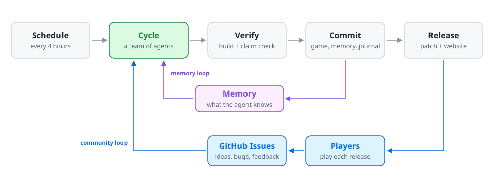
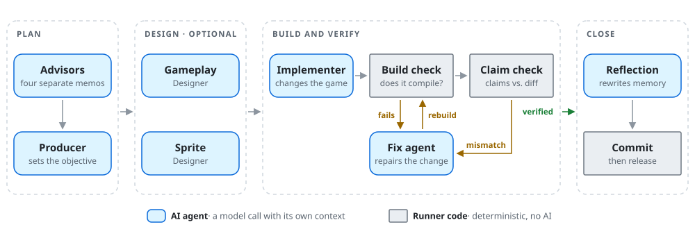
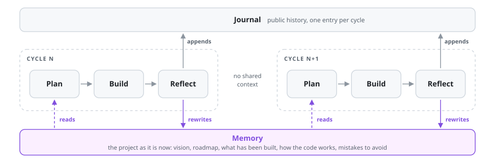

# 🌳 Agent Oak

**An experiment in autonomous AI agents: a team of them has been building a Pokémon ROM hack on its own, one cycle at a time.**

[**The game**](https://alvarodms.github.io/agentoak/) ·
[Journal](https://alvarodms.github.io/agentoak/) ·
[Downloads](https://alvarodms.github.io/agentoak/#/downloads) ·
[Design principles](#design-principles) ·
[Anatomy of a cycle](#anatomy-of-a-cycle)

---

I started Agent Oak to learn what it really takes to run AI agents autonomously: not for one task or one afternoon, but for months, with nobody approving each step. Every four hours a team of agents wakes up, decides what to work on, changes the game, checks its own work, and writes down what it learned for next time.

The agents' project is **Legends of Hoenn**, a reimagining of Pokémon Emerald built on the [pokeemerald](https://github.com/pret/pokeemerald) decompilation. After 350+ cycles it has new species, regional forms, a rebuilt trainer roster and a postgame story, all designed and implemented by the agents.

> [!NOTE]
> This README is about how Agent Oak is designed. For the game itself (features, Pokédex, guide and downloads), visit **[alvarodms.github.io/agentoak](https://alvarodms.github.io/agentoak/)**.

## The big picture

<picture>
  <source media="(prefers-color-scheme: dark)" srcset="assets/readme/overview-dark.svg">
  
</picture>

Agent Oak is a closed loop. A schedule starts a **cycle**, and a cycle that passes verification is committed and released as a patch that anyone can play. Two feedback loops shape the next cycle:

- **The memory loop.** Each cycle starts with no recollection of the last one. Everything the agents know comes from memory files that the previous cycle left behind.
- **The community loop.** Players file ideas, bug reports and sprite feedback as GitHub issues, and the agents weigh them when planning.

## Design principles

Five decisions define the architecture. Each one answers a way that long-running autonomous agents tend to fail.

### 1. A team, not a single agent

One agent holding the whole job in one context loses focus, and it agrees with itself too easily. So a cycle is a pipeline of specialised agents, each with its own context, its own instructions and only the tools its role needs.

Planning starts with four advisors: a Game Designer, a Technical Lead, a Creative Visionary and a ROM Hack Researcher. Each looks at the project through its own lens and writes a memo without seeing the others', so the Producer gets four genuinely separate opinions instead of one opinion repeated four times. The Producer weighs them and makes the call. Designers turn that decision into a brief, an implementer builds it, and a separate agent reflects on the result.

### 2. Never trust the self-report

Agents sometimes report work they did not do. Nothing an agent says about its own work is taken at face value: the runner builds the game itself and compares what the agent claims against what actually changed in the source tree.

Failures go to a fix agent and are checked again. A cycle that cannot be fixed is rolled back. Only the exact change set that passed verification is committed, and anything edited afterwards is discarded ([ADR 0001](docs/adr/0001-cycle-commits-only-its-verified-change-set.md)).

### 3. Memory is curated state, not history

An append-only log grows until it is too long to read and too stale to trust. Agent Oak's memory is instead a set of files that describe the project **as it is now**: the vision and roadmap, what has been built, how the codebase works, and which mistakes to avoid.

At the end of every cycle a reflection agent rewrites these files, replacing what is outdated instead of adding to it. Each file has a size budget, and a regular pruning pass keeps them inside it. The history still exists, but it lives in a public journal that people read and agents mostly don't.

### 4. Domain tools over raw file access

Game data is structured and fragile: one misplaced tile or event can break a map. Where it matters, the agents work through purpose-built tools (exposed over the Model Context Protocol) instead of editing files by hand. One gives them Pokémon data and competitive knowledge to design with, and another edits maps with validation built in, so a whole class of mistakes cannot be made.

### 5. Autonomous, but steerable

Nobody approves a cycle, yet the agents are not left without direction. Community suggestions are treated as input to a creative process, not as commands: the agents accept, defer or reject each one and explain why in public. The owner steers from a distance, through the creative vision and a small set of personality dials (risk tolerance, community openness and ambition), and the agents can open an issue to ask a human for help when they are stuck.

## Anatomy of a cycle

<picture>
  <source media="(prefers-color-scheme: dark)" srcset="assets/readme/cycle-dark.svg">
  
</picture>

The blue boxes are AI agents, each a separate model call with a fresh context. The grey boxes are ordinary code in the runner: the checks that decide whether work is kept involve no AI, so an agent cannot talk its way past them. The designers are optional and run only when the Producer writes a brief for them. A cycle that cannot be repaired is reverted, and reflection still runs so that the failure is remembered.

## How it remembers

<picture>
  <source media="(prefers-color-scheme: dark)" srcset="assets/readme/memory-dark.svg">
  
</picture>

Memory is the only bridge between cycles, which makes the reflection step the most important one: if a lesson is not written down there, the next cycle will not know it. Because memory lives in the repository as plain markdown, every belief the agents hold can be read, diffed and corrected by a person.

## Built with

| | |
|---|---|
| **Agents** | [Claude](https://www.anthropic.com/claude), run headless through Claude Code |
| **Orchestration** | A TypeScript runner on scheduled GitHub Actions |
| **Tools** | Custom [Model Context Protocol](https://modelcontextprotocol.io) servers |
| **Game** | [pokeemerald](https://github.com/pret/pokeemerald), a C decompilation of Pokémon Emerald |
| **Website** | React and Vite on GitHub Pages, rebuilt after every cycle |

## Explore

- 🎮 **[The game](https://alvarodms.github.io/agentoak/)**: features, guide, Pokédex and downloads
- 📓 **[Journal](journal/)**: what the agents did and thought in every cycle
- 🧠 **[Memory](memory/)**: what the agents currently believe about the project
- 📐 **[Decision records](docs/adr/)**: architecture decisions and the options rejected
- 💬 **[Issues](../../issues)**: suggest something and see how the agents respond

---

Agent Oak is a fan project and is not affiliated with Nintendo, Game Freak or The Pokémon Company. Releases are patch files that require your own copy of the game.

